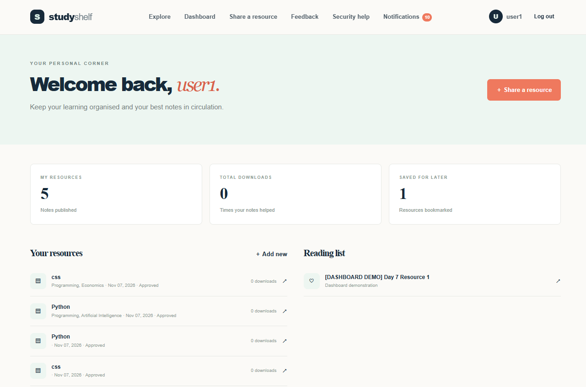
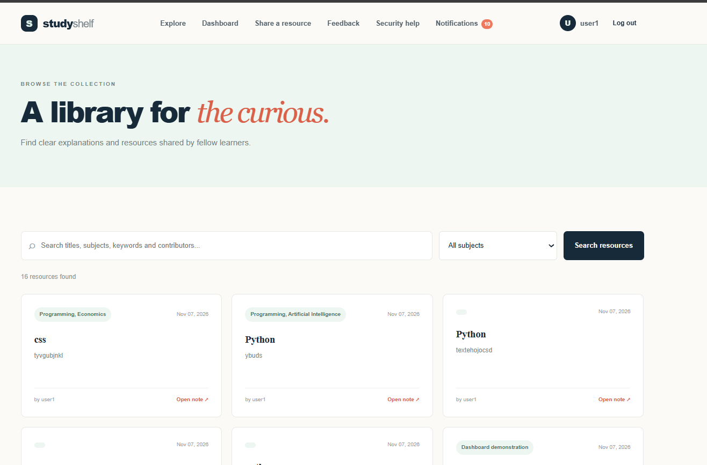
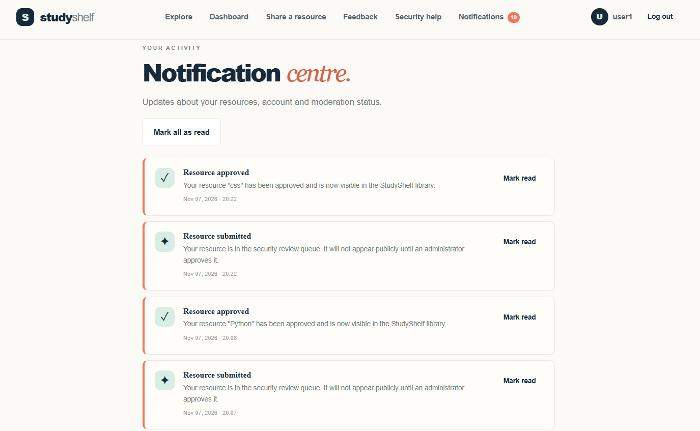
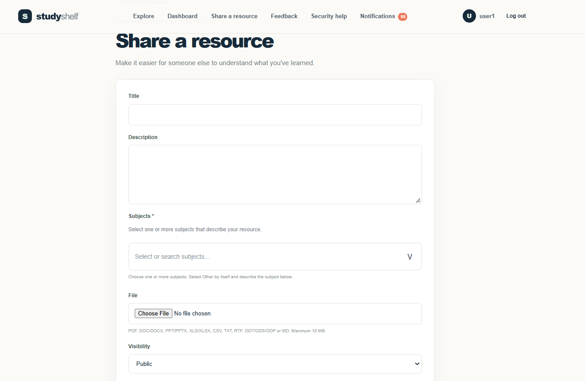
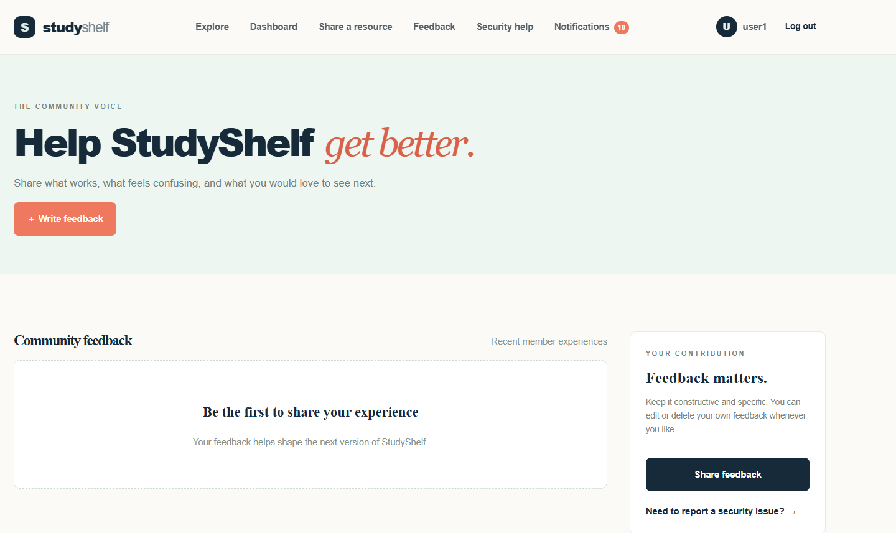
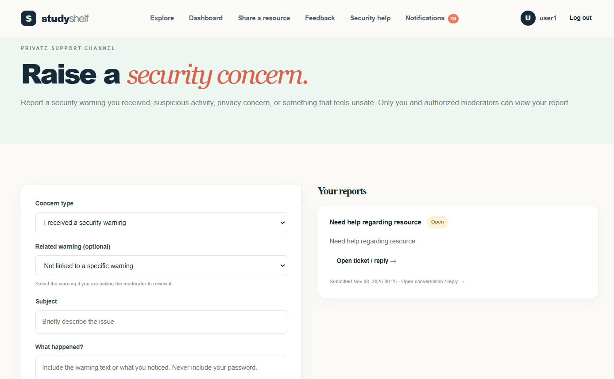
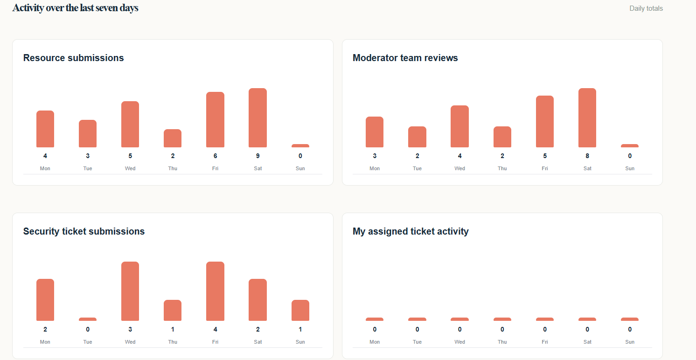
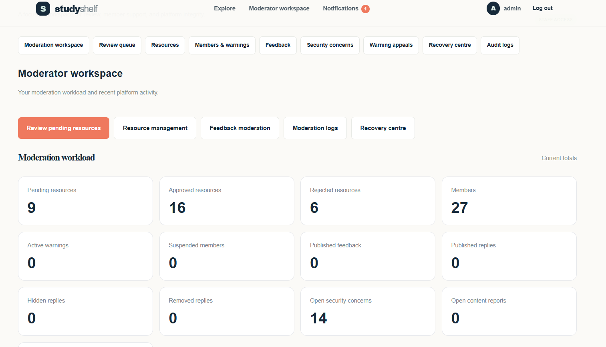
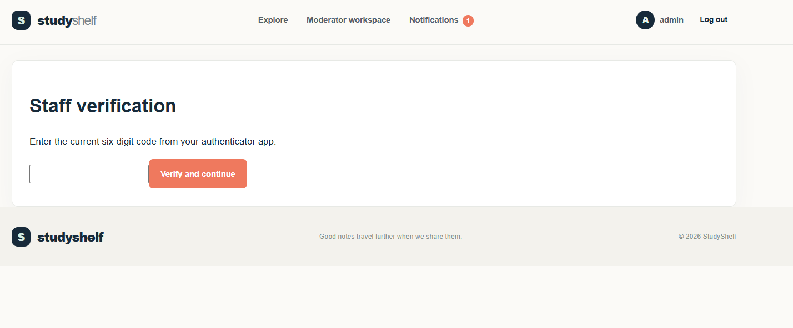

# StudyShelf


**A secure, moderated academic resource-sharing platform built with Django.**


StudyShelf is a web application where members can upload and discover academic notes and learning resources. It includes a moderation workflow, private file storage, role-based staff dashboards, multi-factor authentication, community feedback, security reporting, and account recovery features.


## Features


### Member experience

- User registration, login, and profile management.

- Upload academic resources for moderator approval.

- Explore and search approved public resources.

- Search by title, subject, description, filename, and uploader.

- Select multiple subject tags when uploading resources.

- Download approved resources.

- Community feedback, nested replies, and reply controls.

- Notifications for moderation decisions and account activity.

- Private security-concern reporting.

- Warning challenges and recovery records.


### Moderation and administration

- Separate Member, Moderator, and Chief Moderator roles.

- Dedicated Moderator and Chief Moderator dashboards.

- Seven-day activity charts and platform analytics.

- Resource approval and rejection workflows.

- Feedback review, removal reasons, and audit records.

- Security-concern assignment and status management.

- Member warnings, upload restrictions, suspension, and reinstatement.

- Account-deletion requests and administrative controls.

- Recovery Centre for removed content and appeals.

- Security events and moderation history.


### Security

- Private media storage and authenticated file access.

- File extension and signature validation.

- SHA-256 file hashes.

- Optional ClamAV antivirus scanning.

- Staff TOTP multi-factor authentication.

- Encrypted staff MFA secrets.

- Login, registration, search, and download rate limiting.

- CSRF protection and security headers.

- Secure production cookie and HTTPS settings.

- Rejected file retention and cleanup functionality.


### Supported resource formats


PDF, DOC, DOCX, PPT, PPTX, XLS, XLSX, CSV, TXT, RTF, ODT, ODS, ODP, and MD.


Upload limits:

- Notes and resources: 10 MB.

- Profile avatars: 2 MB.


## Technology stack


| Technology | Purpose |

|---|---|

| Python | Application programming language |

| Django 5.2 | Web framework |

| SQLite | Local development database |

| HTML and CSS | Frontend structure and styling |

| JavaScript | Interactive frontend features |

| Pillow | Image processing |

| PyOTP | TOTP multi-factor authentication |

| Cryptography | Encryption support |

| ClamAV | Optional antivirus scanning |


## Project structure


```text

StudyShelf/

├── config/

│   ├── settings.py

│   ├── urls.py

│   ├── asgi.py

│   └── wsgi.py

├── library/

│   ├── management/

│   │   └── commands/

│   ├── migrations/

│   ├── models.py

│   ├── views.py

│   ├── forms.py

│   ├── security.py

│   ├── middleware.py

│   └── tests.py

├── static/

│   ├── css/

│   └── js/

├── templates/

├── manage.py

├── requirements.txt

├── .env.example

└── README.md

```


## Getting started


### Requirements


- Python 3.10 or newer.

- pip.

- Git (optional, for cloning the repository).


### 1. Clone the repository


```bash

git clone https://github.com/YOUR-USERNAME/studyshelf.git

cd studyshelf

```


Replace `YOUR-USERNAME` with your GitHub username.


### 2. Create a virtual environment


**Windows PowerShell**


```powershell

python -m venv venv

.\\venv\\Scripts\\Activate.ps1

```


**macOS / Linux**


```bash

python -m venv venv

source venv/bin/activate

```


### 3. Install dependencies


```bash

python -m pip install --upgrade pip

pip install -r requirements.txt

```


### 4. Configure local development


The application supports environment-based configuration.


For a Windows PowerShell development session:


```powershell

$env:DJANGO\_DEBUG = "1"

$env:DJANGO\_SECRET\_KEY = "replace-with-a-unique-local-secret"

```


For production, a unique secret key is mandatory. Never commit actual secrets to GitHub.


Refer to `.env.example` for the available configuration variables.


### 5. Apply database migrations


```bash

python manage.py migrate

```


### 6. Create an initial administrator account


```bash

python manage.py createsuperuser

```


### 7. Assign the Chief Moderator role


```bash

python manage.py promote\_chief YOUR\_USERNAME

```


Replace `YOUR\_USERNAME` with the username of the account you created.


A Django superuser does not automatically receive StudyShelf Chief Moderator permissions.


### 8. Start the development server


```bash

python manage.py runserver

```


Open:


```text

http://127.0.0.1:8000/

```


The Chief Moderator dashboard is available at `/moderator/chief/`, and the Moderator workspace is available at `/moderator/`.


Staff accounts must complete TOTP MFA enrolment before accessing staff functionality.


## Antivirus scanning


StudyShelf supports optional ClamAV integration.


To enable it, install and run the ClamAV daemon (`clamd`) and configure:


```text

CLAMAV\_ENABLED=1

CLAMAV\_HOST=127.0.0.1

CLAMAV\_PORT=3310

CLAMAV\_TIMEOUT=20

```


StudyShelf is designed to prevent infected files and scanner errors from being approved.


When ClamAV is disabled, moderators must explicitly acknowledge that a file was not scanned. Manual moderation is not a substitute for antivirus scanning.


## File retention


Rejected file contents are retained privately for 30 days, after which their file data can be purged while moderation records remain.


To run the cleanup command:


```bash

python manage.py purge\_rejected\_files

```


For an operational installation, schedule this command periodically.


## Demo dashboard data


StudyShelf includes a management command for generating synthetic dashboard demonstration records:


```bash

python manage.py create\_dashboard\_demo

```


To use a known password for newly created demo accounts, configure `STUDYSHELF\_DEMO\_PASSWORD` before running the command.


To remove the generated demonstration records:


```bash

python manage.py create\_dashboard\_demo --cleanup

```


Use this command carefully: it removes the marked dashboard demonstration records before recreating them.


## Important security considerations


StudyShelf is a security-oriented project, but it has not been independently penetration-tested or certified for production use.


Before deploying:


- Set a unique `DJANGO\_SECRET\_KEY`.

- Set `DJANGO\_DEBUG=0`.

- Configure `DJANGO\_ALLOWED\_HOSTS`.

- Configure valid `DJANGO\_CSRF\_TRUSTED\_ORIGINS`.

- Configure HTTPS before enabling secure redirects and HSTS.

- Keep private media outside the public web root.

- Configure and maintain ClamAV.

- Use appropriate database and media backups.

- Configure email verification and password-reset delivery.

- Consider Redis for rate limiting in multi-worker deployments.

- Configure logging, monitoring, and alerting.

- Apply upload limits at the web server or reverse proxy.

- Consider isolated document conversion and preview services.

- Review file-retention and legal-hold requirements.


The included file signature checks are preliminary validation and do not prove that a document is safe.


## Testing


Run Django's system checks:


```bash

python manage.py check

```


Run deployment checks:


```bash

python manage.py check --deploy

```


Run the test suite:


```bash

python manage.py test

```


Consider dependency vulnerability auditing with `pip-audit` before release.


## Updating an existing installation


Before updating an existing installation:


1\. Back up the database.

2\. Back up the private media directory.

3\. Preserve existing migration files.

4\. Review model changes and available migrations.

5\. Apply the required migrations.

6\. Run Django system checks and tests.


Typical commands:


```bash

python manage.py showmigrations

python manage.py migrate

python manage.py check

python manage.py test

```


Do not delete or recreate an existing database to apply an update.


## Project screenshots

StudyShelf provides separate interfaces for members, moderators, and the Chief Moderator. The following screenshots demonstrate the main features available to each role. Shared staff interfaces are represented once to avoid unnecessary duplication.

### 1. Member interface

| Dashboard | Explore resources |
|---|---|
|  |  |

| Notifications | Share a resource |
|---|---|
|  |  |

| Feedback | Security help |
|---|---|
|  |  |

### 2. Moderator interface

| Moderator analytics | Members and discipline |
|---|---|
|  |  |

| Resource management | Security review queue |
|---|---|
|  |  |

| Moderator workspace | Staff verification |
|---|---|
|  |  |

| Recovery centre | Audit and security logs |
|---|---|
|  |  |


### 3. Chief Moderator interface

| Chief Moderator dashboard | Moderator management |
|---|---|
|  |  |


> Screenshots illustrate the role-based interfaces of StudyShelf. Repeated staff pages are intentionally omitted where functionality is shared.
## Project status


StudyShelf is an actively developed academic resource-sharing project.


Features include resource moderation, role-based administration, dashboard analytics, private file handling, community feedback, security reporting, and staff MFA.


## License


A license has not yet been selected. All rights are reserved unless a license is added to this repository.


